# Free HTML website templates

75 static HTML/CSS templates made with
[Swebsy](https://swebsy.com), a free visual website builder. Each folder's
`site/` is a complete website: open `index.html`, or upload the folder to
GitHub Pages, Netlify, Cloudflare Pages or any static host.

Prefer to edit visually? **Edit in Swebsy** opens the template in the browser
editor, free and with no account.

### [Oak](oak/)

[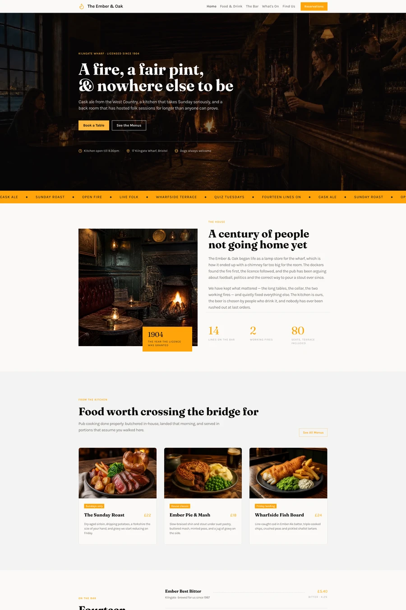](oak/)

A warm, editorial multi-page pub and dining template with rich imagery, menus, events, venue information, and external reservations.

[Live demo](https://studio.swebsy.com/templates/oak/preview/) · [Edit in Swebsy](https://studio.swebsy.com/create?template=oak&ref=github) · [Details](https://swebsy.com/templates/oak/)

### [Ember](ember/)

[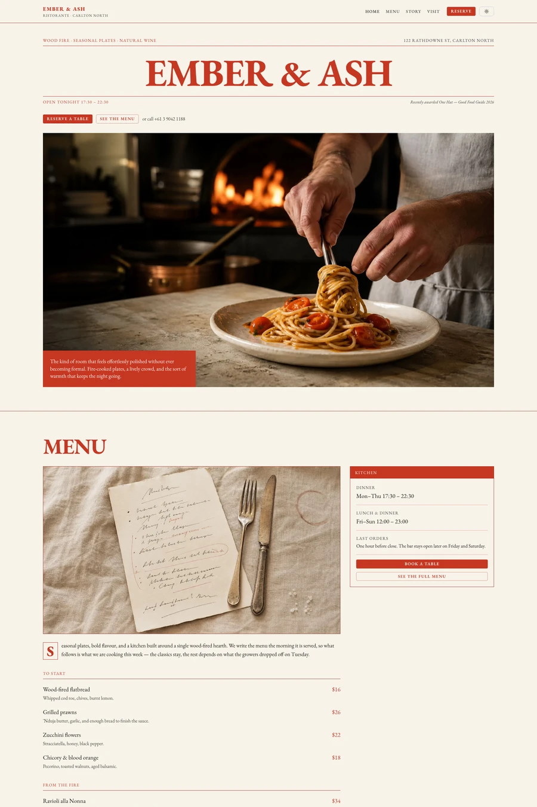](ember/)

A wood-fired restaurant site in warm paper and ember red: oversized serif display type, ruled editorial sections, priced menu lists and a booking-first call to action.

[Live demo](https://studio.swebsy.com/templates/ember/preview/) · [Edit in Swebsy](https://studio.swebsy.com/create?template=ember&ref=github) · [Details](https://swebsy.com/templates/ember/)

### [Folio](folio/)

A clean, single-page portfolio template that gives independent creators a direct way to introduce themselves and highlight selected work.

[Live demo](https://studio.swebsy.com/templates/folio/preview/) · [Edit in Swebsy](https://studio.swebsy.com/create?template=folio&ref=github) · [Details](https://swebsy.com/templates/folio/)

### [Pulsar](pulsar/)

[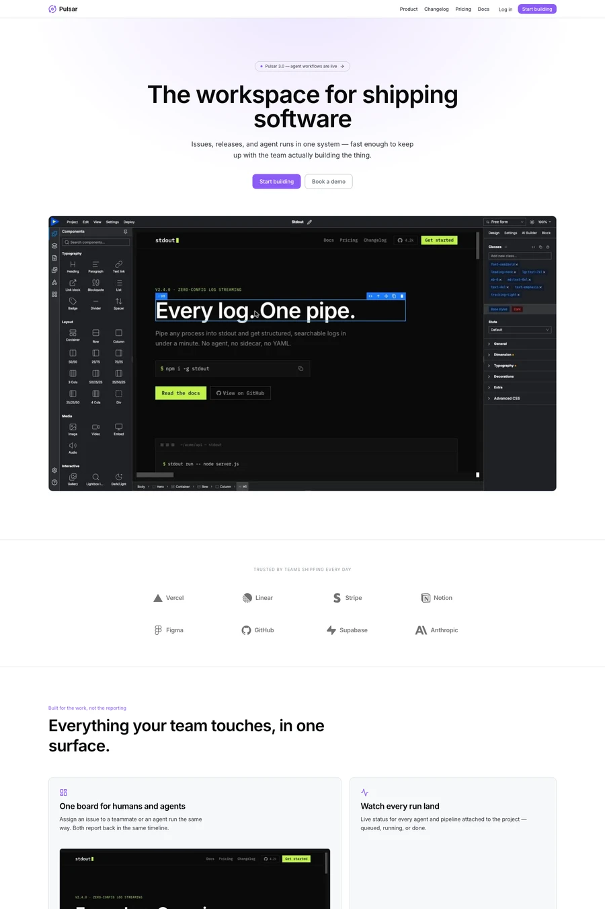](pulsar/)

A dark-first product site for developer tools and B2B SaaS, with a glowing centered hero, bento feature grid, logo wall, three-tier pricing and a changelog page.

[Live demo](https://studio.swebsy.com/templates/pulsar/preview/) · [Edit in Swebsy](https://studio.swebsy.com/create?template=pulsar&ref=github) · [Details](https://swebsy.com/templates/pulsar/)

### [Cindermoth](cindermoth/)

[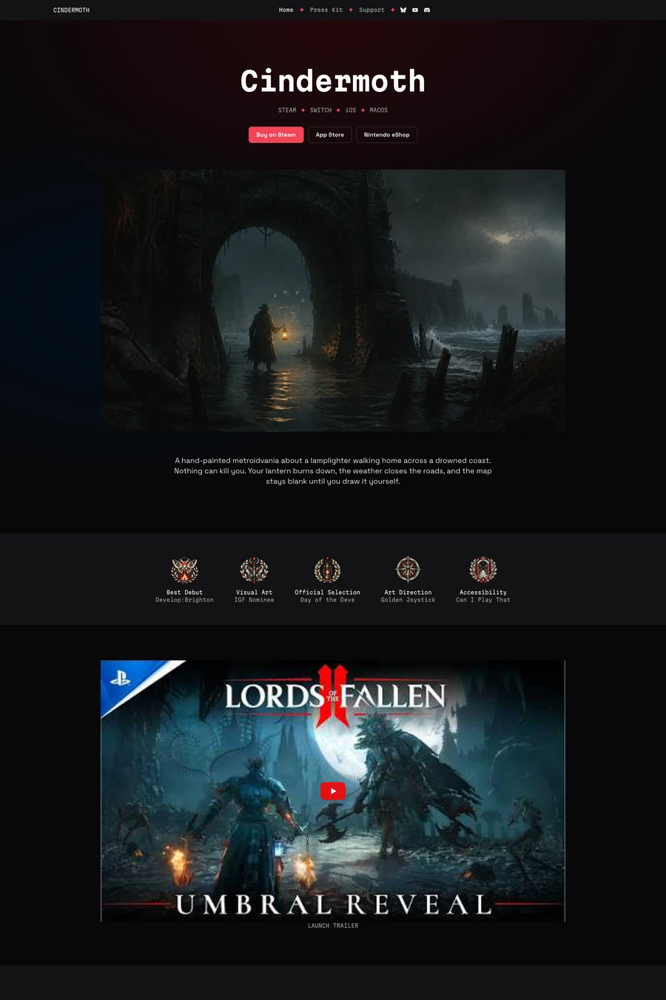](cindermoth/)

A dark editorial launch and press-kit template for indie games, with cinematic galleries, store calls to action, support resources, and legal pages.

[Live demo](https://studio.swebsy.com/templates/cindermoth/preview/) · [Edit in Swebsy](https://studio.swebsy.com/create?template=cindermoth&ref=github) · [Details](https://swebsy.com/templates/cindermoth/)

### [Fennel](fennel/)

[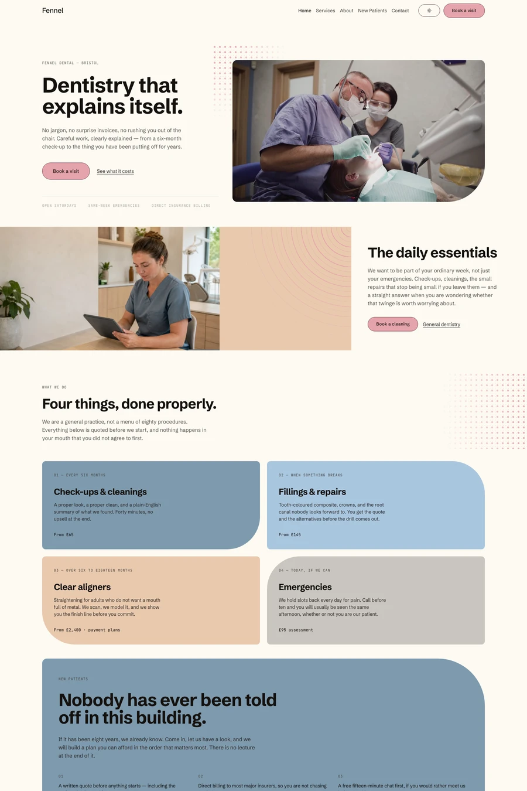](fennel/)

A calm five-page template for dental and health practices: flat pastel panels, full-bleed photo bands, plain-spoken pricing and a booking CTA on every page.

[Live demo](https://studio.swebsy.com/templates/fennel/preview/) · [Edit in Swebsy](https://studio.swebsy.com/create?template=fennel&ref=github) · [Details](https://swebsy.com/templates/fennel/)

### [Ironside](ironside/)

[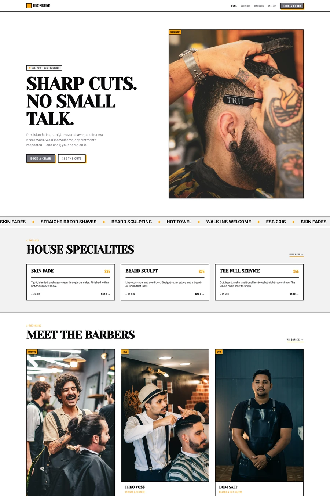](ironside/)

A bold neo-brutalist barbershop template with hard borders, offset shadows, expressive type, services, pricing, and booking details.

[Live demo](https://studio.swebsy.com/templates/ironside/preview/) · [Edit in Swebsy](https://studio.swebsy.com/create?template=ironside&ref=github) · [Details](https://swebsy.com/templates/ironside/)

### [Nimbus](nimbus/)

[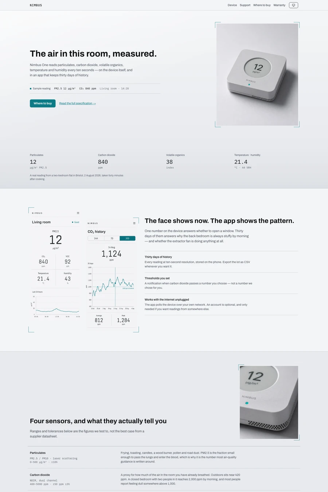](nimbus/)

An instrument-precise template for a hardware product and its app, with a full specification, a support hub with firmware release notes, a retailer directory and a warranty page.

[Live demo](https://studio.swebsy.com/templates/nimbus/preview/) · [Edit in Swebsy](https://studio.swebsy.com/create?template=nimbus&ref=github) · [Details](https://swebsy.com/templates/nimbus/)

### [Plumb](plumb/)

[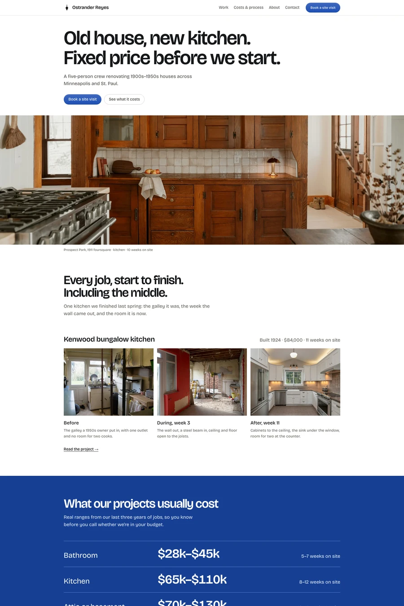](plumb/)

A renovation-contractor website for older houses: before, during and after photos for every job, a price list set in large type, and a site-visit request form.

[Live demo](https://studio.swebsy.com/templates/plumb/preview/) · [Edit in Swebsy](https://studio.swebsy.com/create?template=plumb&ref=github) · [Details](https://swebsy.com/templates/plumb/)

### [Neon Nocturne](neon-nocturne-link-in-bio/)

[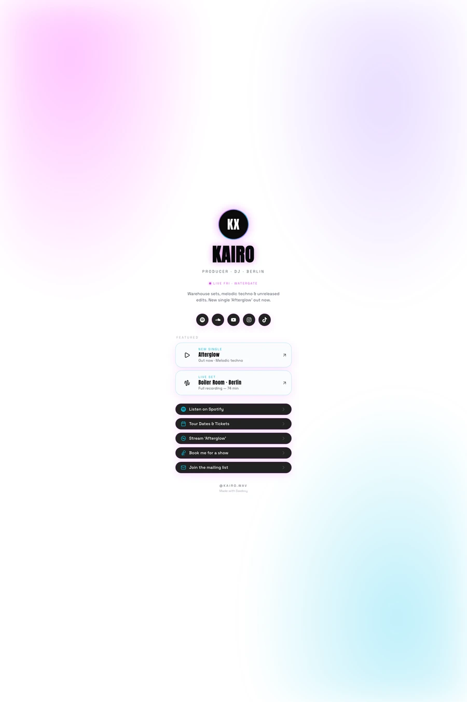](neon-nocturne-link-in-bio/)

A club-ready link-in-bio template with featured releases, live sets, social profiles, and glowing link buttons over animated neon spotlights.

[Live demo](https://studio.swebsy.com/templates/neon-nocturne-link-in-bio/preview/) · [Edit in Swebsy](https://studio.swebsy.com/create?template=neon-nocturne-link-in-bio&ref=github) · [Details](https://swebsy.com/templates/neon-nocturne-link-in-bio/)

### [Afterparty](afterparty/)

[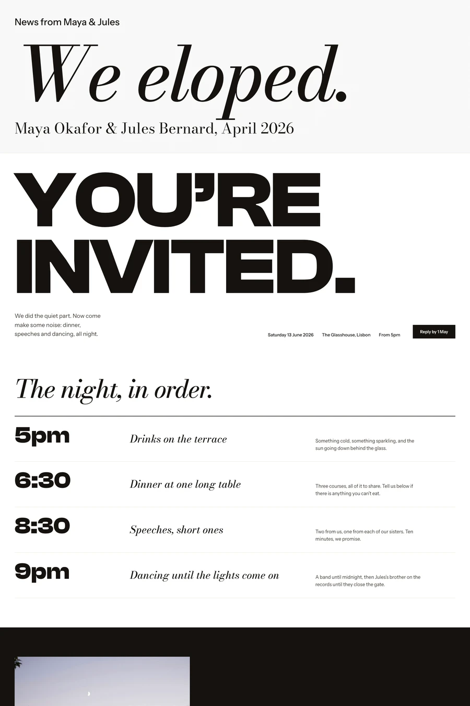](afterparty/)

A one-page party invitation that opens as you scroll: a card that says "We eloped." swings open to "You're invited.", then the night in order, the venue, what to know and an RSVP.

[Live demo](https://studio.swebsy.com/templates/afterparty/preview/) · [Edit in Swebsy](https://studio.swebsy.com/create?template=afterparty&ref=github) · [Details](https://swebsy.com/templates/afterparty/)

### [Atelier](atelier/)

[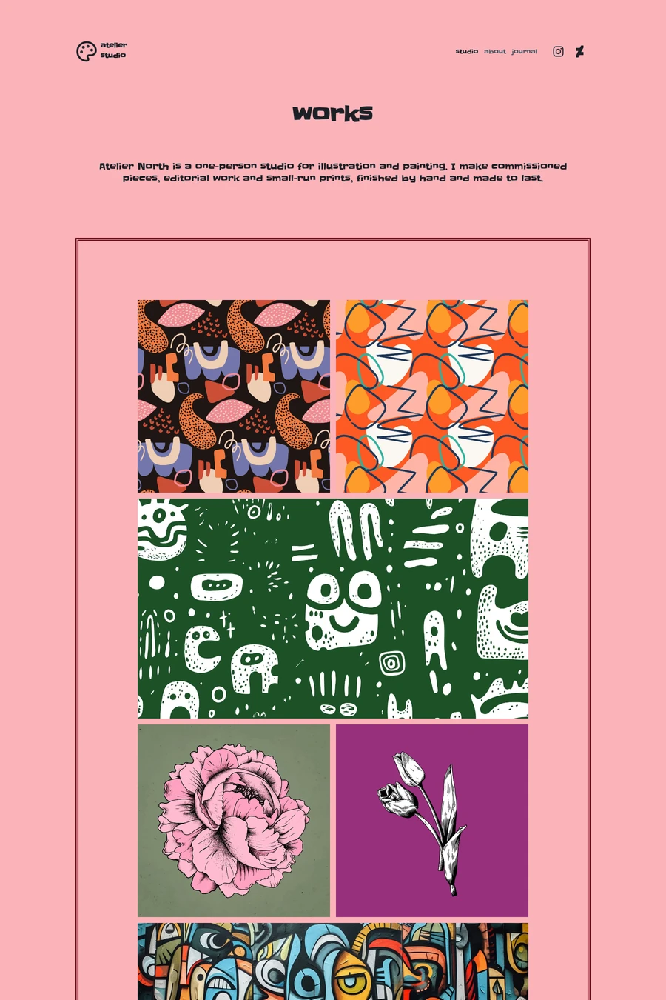](atelier/)

Showcase your work in a clean, gallery-inspired portfolio designed to let each artwork, project, and studio story speak first.

[Live demo](https://studio.swebsy.com/templates/atelier/preview/) · [Edit in Swebsy](https://studio.swebsy.com/create?template=atelier&ref=github) · [Details](https://swebsy.com/templates/atelier/)

### [Calltime](calltime/)

[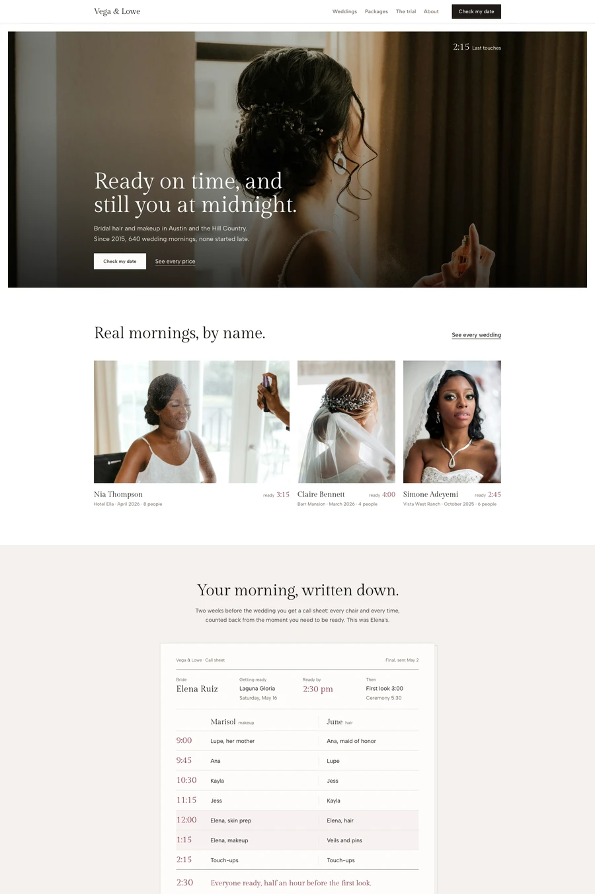](calltime/)

A bridal hair and makeup website for a two-artist team: named weddings with ready-by times, a printed call sheet of the morning, every price, and a trial studio page.

[Live demo](https://studio.swebsy.com/templates/calltime/preview/) · [Edit in Swebsy](https://studio.swebsy.com/create?template=calltime&ref=github) · [Details](https://swebsy.com/templates/calltime/)

### [Primer](primer/)

[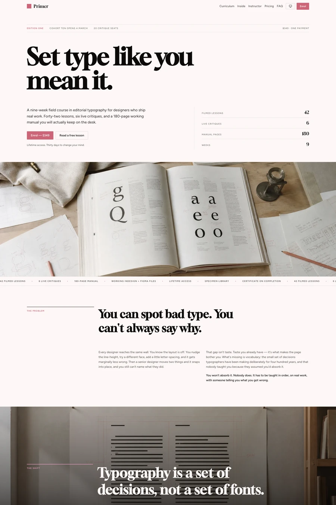](primer/)

A two-page editorial template for a paid online course: hairline rules and a display serif instead of cards, plus a full sample lesson to give away.

[Live demo](https://studio.swebsy.com/templates/primer/preview/) · [Edit in Swebsy](https://studio.swebsy.com/create?template=primer&ref=github) · [Details](https://swebsy.com/templates/primer/)

### [Stdout](stdout/)

[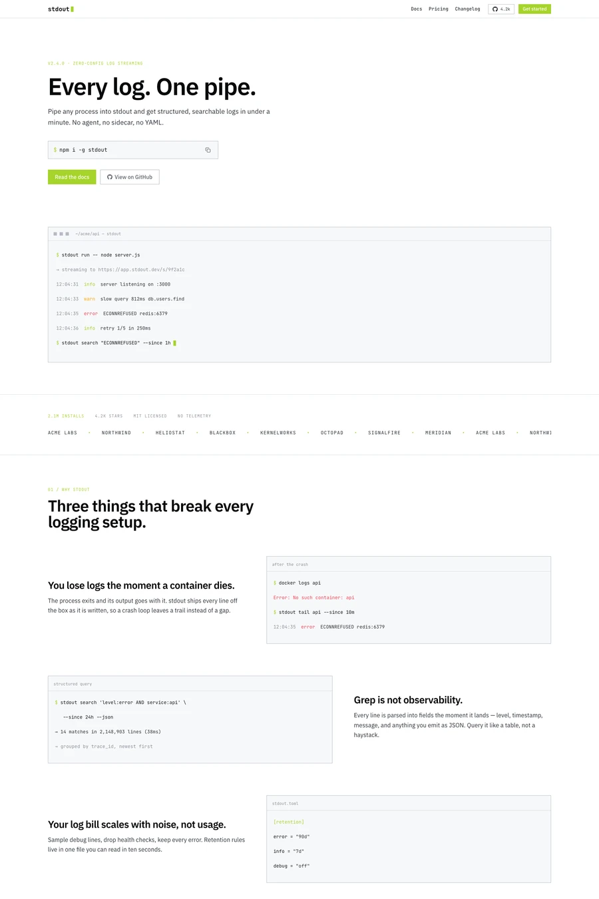](stdout/)

A dark terminal-inspired developer tool template with product storytelling, pricing, changelog, legal, and conversion pages.

[Live demo](https://studio.swebsy.com/templates/stdout/preview/) · [Edit in Swebsy](https://studio.swebsy.com/create?template=stdout&ref=github) · [Details](https://swebsy.com/templates/stdout/)

### [Booked](booked/)

[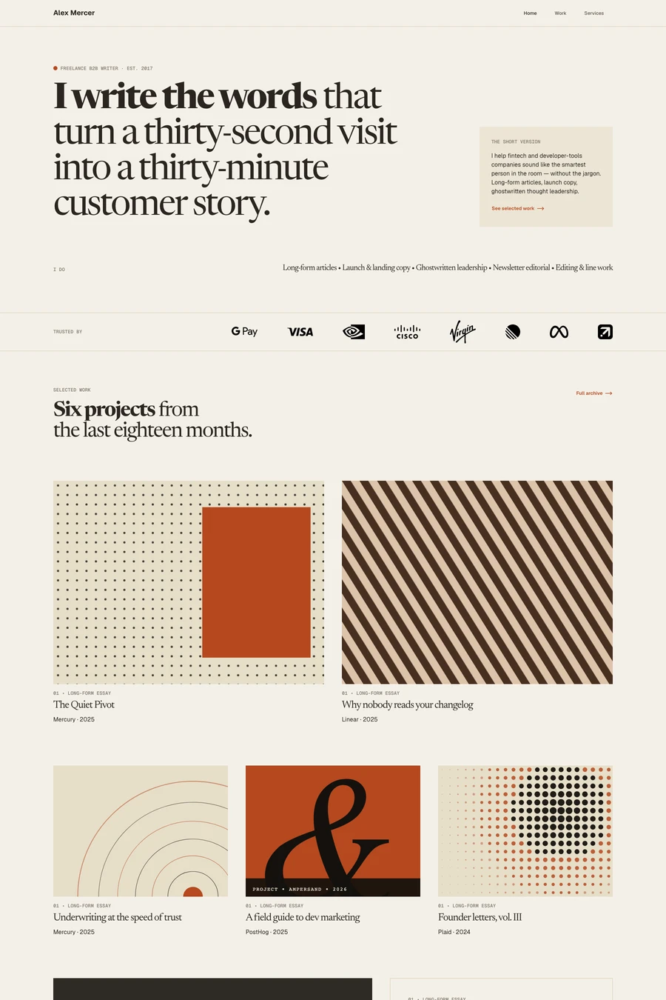](booked/)

An editorial services template for independent specialists who need to present their work, explain their offers, and turn interest into inquiries.

[Live demo](https://studio.swebsy.com/templates/booked/preview/) · [Edit in Swebsy](https://studio.swebsy.com/create?template=booked&ref=github) · [Details](https://swebsy.com/templates/booked/)

### [Tally](tally/)

[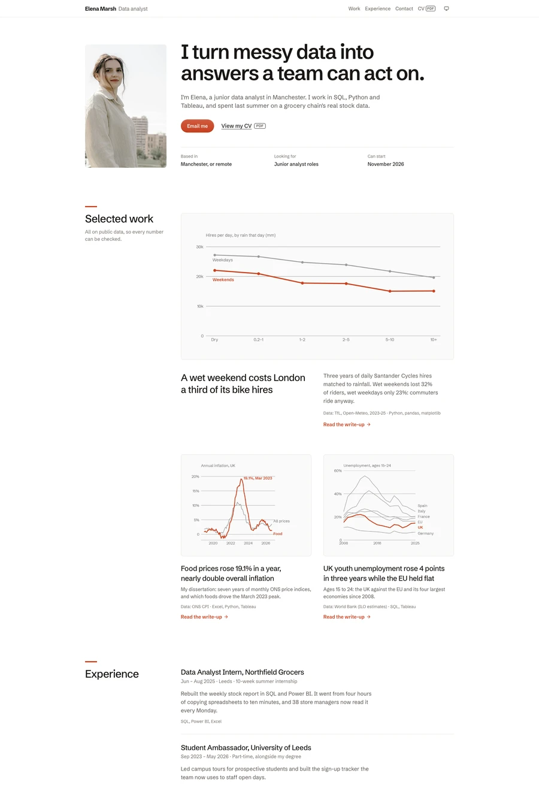](tally/)

A CV website for a new data analyst: real charts as the work, a dated experience ledger, a PDF CV link and a detailed project write-up.

[Live demo](https://studio.swebsy.com/templates/tally/preview/) · [Edit in Swebsy](https://studio.swebsy.com/create?template=tally&ref=github) · [Details](https://swebsy.com/templates/tally/)

### [Between](between/)

[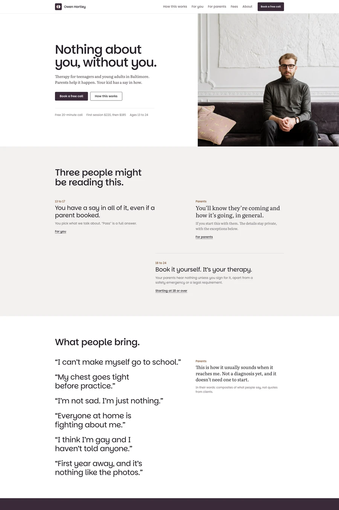](between/)

A six-page template for a therapist who sees teens and young adults: each page speaks to the young person and the parent, with privacy and fees up front.

[Live demo](https://studio.swebsy.com/templates/between/preview/) · [Edit in Swebsy](https://studio.swebsy.com/create?template=between&ref=github) · [Details](https://swebsy.com/templates/between/)

### [Fairweather](fairweather/)

[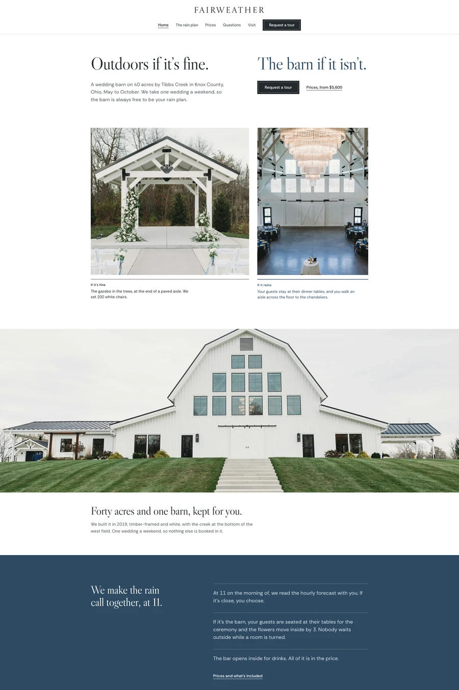](fairweather/)

A four-page template for an owner-run wedding barn: every place is shown with its rain plan in a second ink, with prices and tours up front.

[Live demo](https://studio.swebsy.com/templates/fairweather/preview/) · [Edit in Swebsy](https://studio.swebsy.com/create?template=fairweather&ref=github) · [Details](https://swebsy.com/templates/fairweather/)

### [Setpoint](setpoint/)

[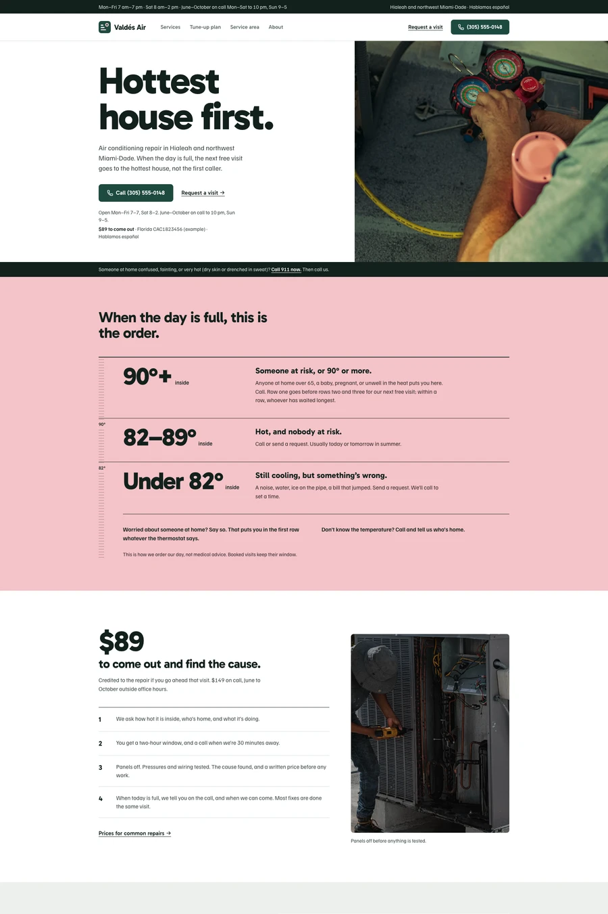](setpoint/)

A five-page template for a two-person AC repair company: the hottest house goes first, shown as a ranked temperature scale, with prices and the phone up front.

[Live demo](https://studio.swebsy.com/templates/setpoint/preview/) · [Edit in Swebsy](https://studio.swebsy.com/create?template=setpoint&ref=github) · [Details](https://swebsy.com/templates/setpoint/)

### [Free Edge](free-edge/)

[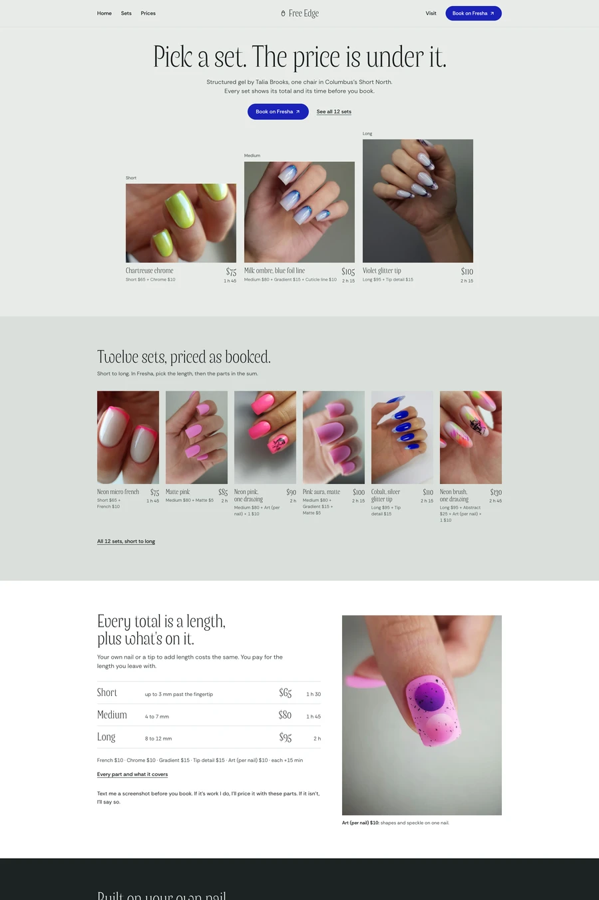](free-edge/)

A one-chair nail studio site where every set shows its total and its time: a staircase of hands stepping with length, sets priced as booked, and a price page with no "from".

[Live demo](https://studio.swebsy.com/templates/free-edge/preview/) · [Edit in Swebsy](https://studio.swebsy.com/create?template=free-edge&ref=github) · [Details](https://swebsy.com/templates/free-edge/)

### [Slackwater](slackwater/)

[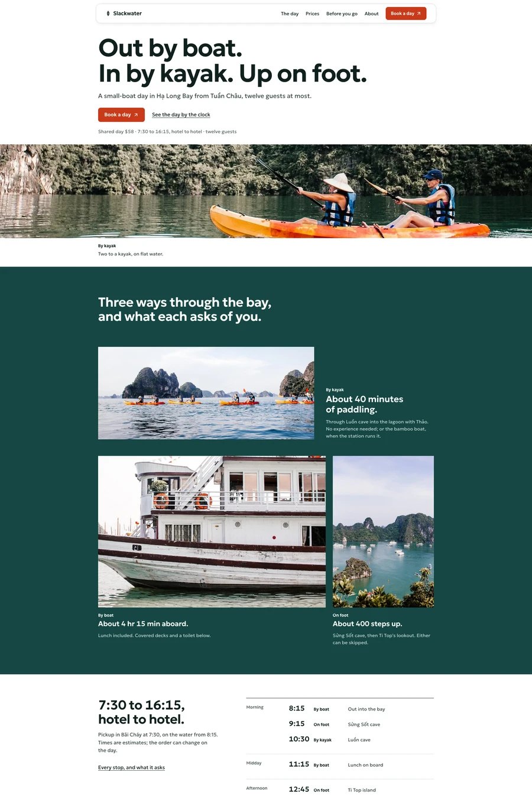](slackwater/)

A one-boat day-trip company in Hạ Long Bay: the day as three ways of moving, each with its own photo shape, effort in numbers and an opt-out, plus prices, rules and the crew.

[Live demo](https://studio.swebsy.com/templates/slackwater/preview/) · [Edit in Swebsy](https://studio.swebsy.com/create?template=slackwater&ref=github) · [Details](https://swebsy.com/templates/slackwater/)

### [Good Work](good-work/)

[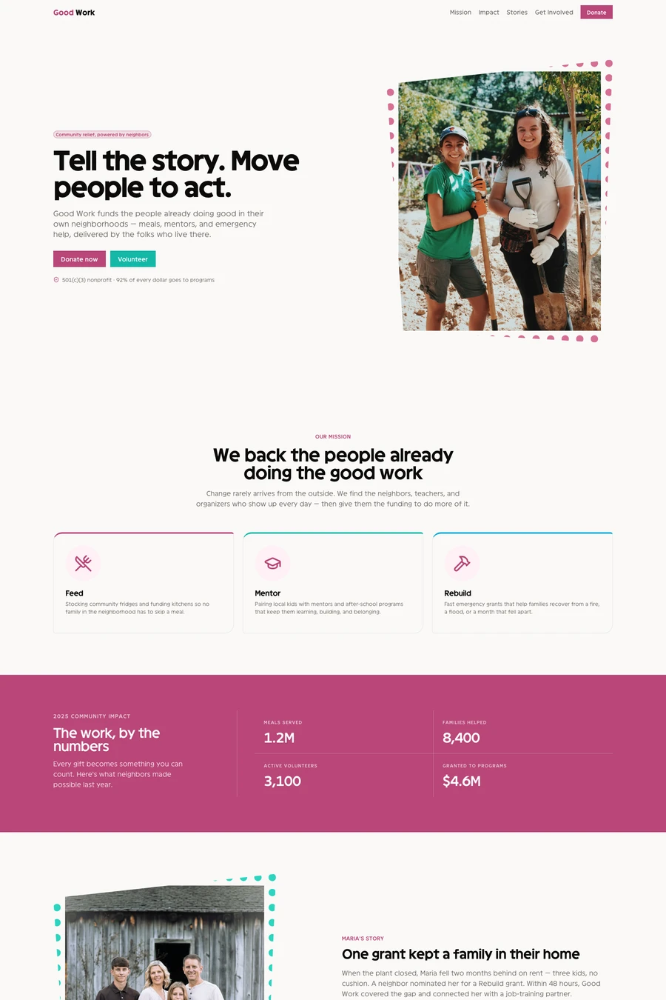](good-work/)

A bold multi-page nonprofit template for community relief, transparent impact reporting, fundraising, volunteer opportunities, and human stories.

[Live demo](https://studio.swebsy.com/templates/good-work/preview/) · [Edit in Swebsy](https://studio.swebsy.com/create?template=good-work&ref=github) · [Details](https://swebsy.com/templates/good-work/)

### [Cadenza](cadenza/)

[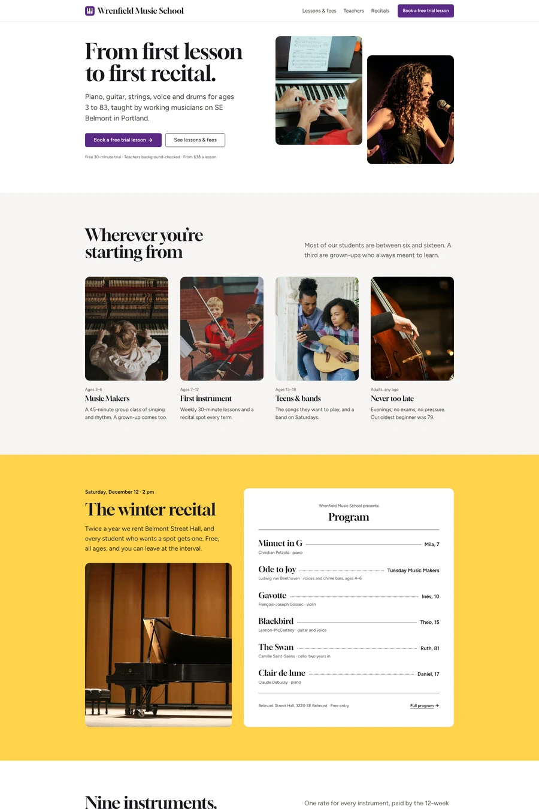](cadenza/)

A community music school website: lessons by age, one rate for every instrument, teachers who still perform, and the next student recital set as a printed concert program.

[Live demo](https://studio.swebsy.com/templates/cadenza/preview/) · [Edit in Swebsy](https://studio.swebsy.com/create?template=cadenza&ref=github) · [Details](https://swebsy.com/templates/cadenza/)

### [Red Door](red-door/)

[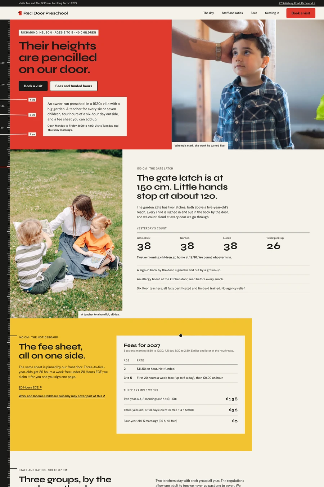](red-door/)

A preschool site read down a doorframe: each section hangs at its real height, from the gate latch to the fee noticeboard to the skirting.

[Live demo](https://studio.swebsy.com/templates/red-door/preview/) · [Edit in Swebsy](https://studio.swebsy.com/create?template=red-door&ref=github) · [Details](https://swebsy.com/templates/red-door/)

### [Sixth Week](sixth-week/)

[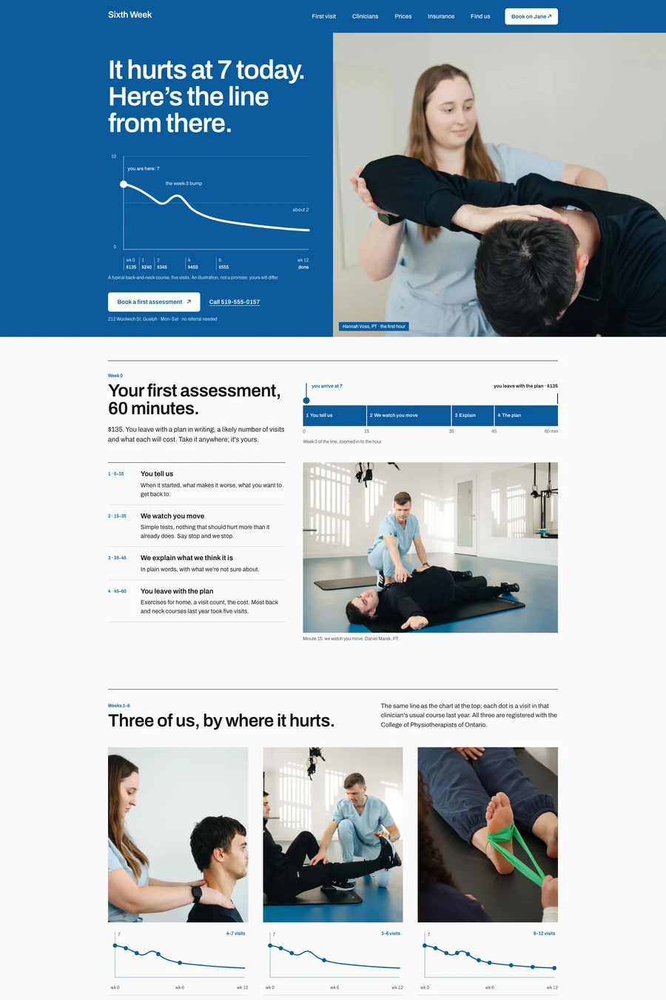](sixth-week/)

A physio clinic site drawn as one 12-week recovery line, re-cropped per section, with visit counts and prices shown up front.

[Live demo](https://studio.swebsy.com/templates/sixth-week/preview/) · [Edit in Swebsy](https://studio.swebsy.com/create?template=sixth-week&ref=github) · [Details](https://swebsy.com/templates/sixth-week/)

### [Twelve](twelve/)

[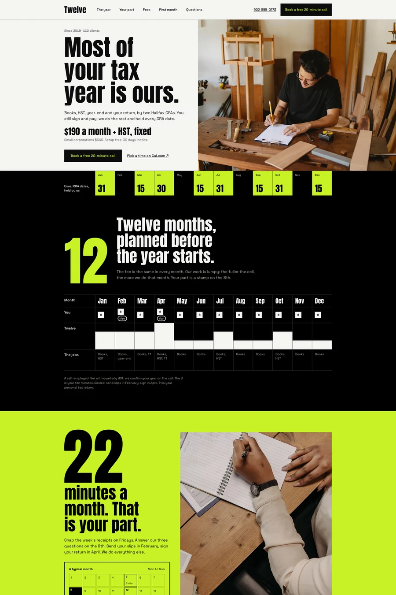](twelve/)

A two-partner accounting practice set as a wall planner: every CRA date filled in lime, the fixed fee in each month, your 22 minutes.

[Live demo](https://studio.swebsy.com/templates/twelve/preview/) · [Edit in Swebsy](https://studio.swebsy.com/create?template=twelve&ref=github) · [Details](https://swebsy.com/templates/twelve/)

### [Keane & Hurley](keane-hurley/)

[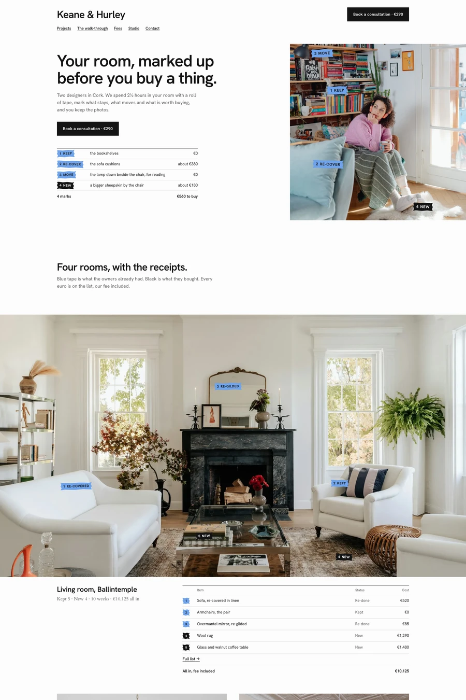](keane-hurley/)

An interior studio whose every photo is a room marked up with painter's tape, each numbered tab keyed to a priced list of what stayed and what was bought.

[Live demo](https://studio.swebsy.com/templates/keane-hurley/preview/) · [Edit in Swebsy](https://studio.swebsy.com/create?template=keane-hurley&ref=github) · [Details](https://swebsy.com/templates/keane-hurley/)

### [Last Customer](last-customer/)

[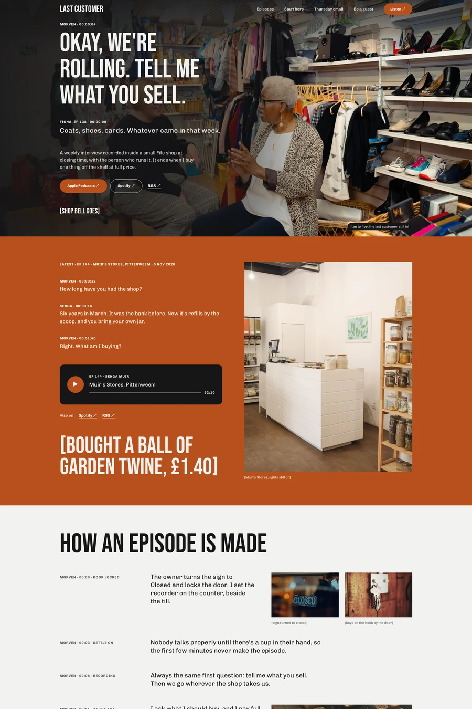](last-customer/)

A shop-interview podcast set as its own transcript: timecoded turns, and every episode closes on the bracketed thing the host bought.

[Live demo](https://studio.swebsy.com/templates/last-customer/preview/) · [Edit in Swebsy](https://studio.swebsy.com/create?template=last-customer&ref=github) · [Details](https://swebsy.com/templates/last-customer/)

### [Daybook Hair](daybook-hair/)

[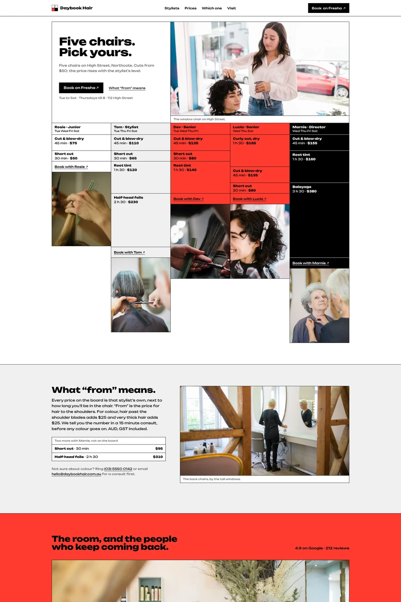](daybook-hair/)

A salon home page laid out as the day book: one column per stylist, junior to director, each service block as tall as it takes, priced.

[Live demo](https://studio.swebsy.com/templates/daybook-hair/preview/) · [Edit in Swebsy](https://studio.swebsy.com/create?template=daybook-hair&ref=github) · [Details](https://swebsy.com/templates/daybook-hair/)

### [Eighty Ten](eighty-ten/)

[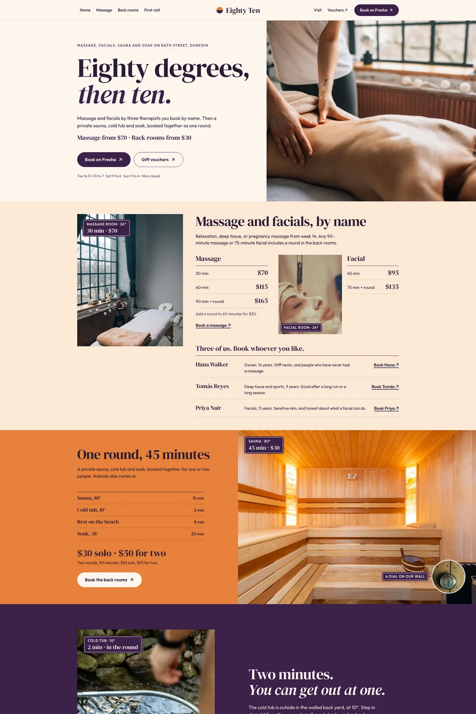](eighty-ten/)

A massage studio and private bathhouse laid out as the walk through the building, each room its own colour at its own temperature.

[Live demo](https://studio.swebsy.com/templates/eighty-ten/preview/) · [Edit in Swebsy](https://studio.swebsy.com/create?template=eighty-ten&ref=github) · [Details](https://swebsy.com/templates/eighty-ten/)

### [Clarity](clarity/)

[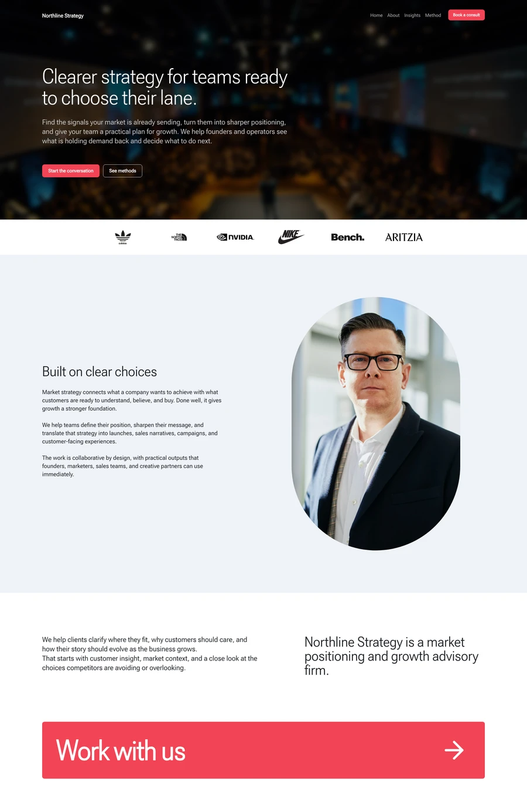](clarity/)

A polished advisory template for consultants and strategy firms to present their method, proof, workshops, and inquiry path with confidence.

[Live demo](https://studio.swebsy.com/templates/clarity/preview/) · [Edit in Swebsy](https://studio.swebsy.com/create?template=clarity&ref=github) · [Details](https://swebsy.com/templates/clarity/)

### [Marquee](marquee/)

[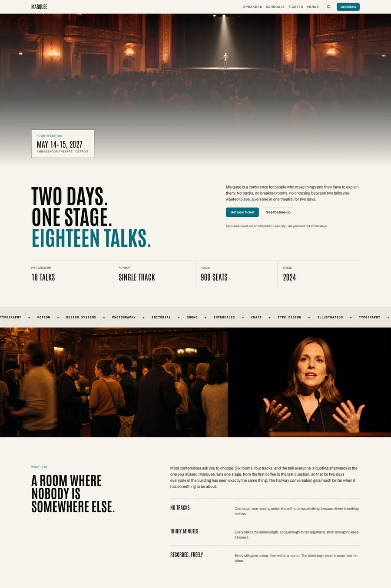](marquee/)

A photography-led conference site: full-bleed image plates, hairline-ruled schedules and ticket tiers, and a warm near-black ground that lets the pictures carry all the colour.

[Live demo](https://studio.swebsy.com/templates/marquee/preview/) · [Edit in Swebsy](https://studio.swebsy.com/create?template=marquee&ref=github) · [Details](https://swebsy.com/templates/marquee/)

### [Proof](proof/)

[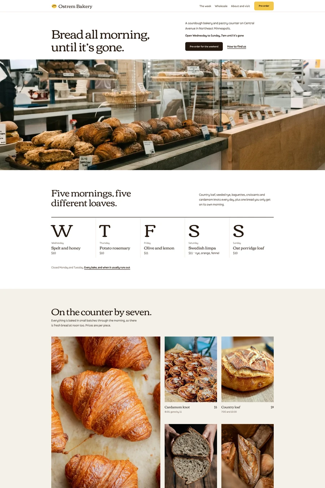](proof/)

A neighborhood bakery website: the week's breads by day, a photo shelf with prices and times, weekend and cake pre-orders, wholesale for cafés, and the two owners.

[Live demo](https://studio.swebsy.com/templates/proof/preview/) · [Edit in Swebsy](https://studio.swebsy.com/create?template=proof&ref=github) · [Details](https://swebsy.com/templates/proof/)

### [Tolland](tolland/)

[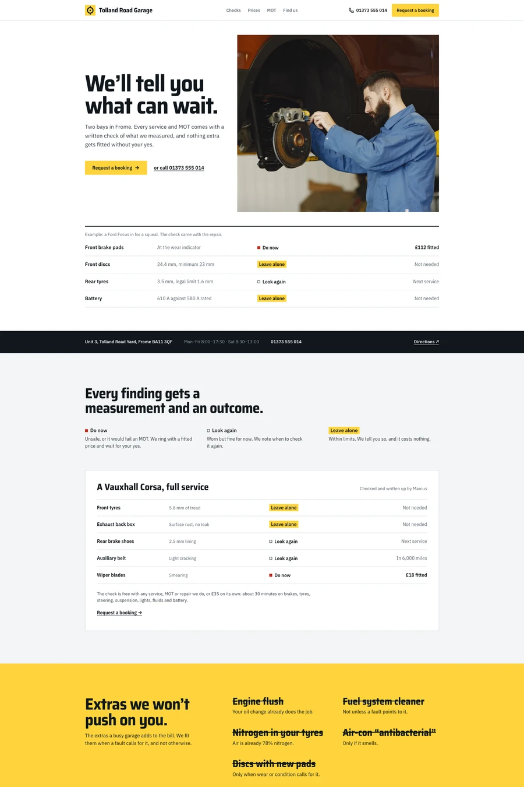](tolland/)

A two-bay independent garage that tells you what can wait: every finding gets a measurement and an outcome, Leave alone marked in hi-vis yellow.

[Live demo](https://studio.swebsy.com/templates/tolland/preview/) · [Edit in Swebsy](https://studio.swebsy.com/create?template=tolland&ref=github) · [Details](https://swebsy.com/templates/tolland/)

### [Juno](juno/)

[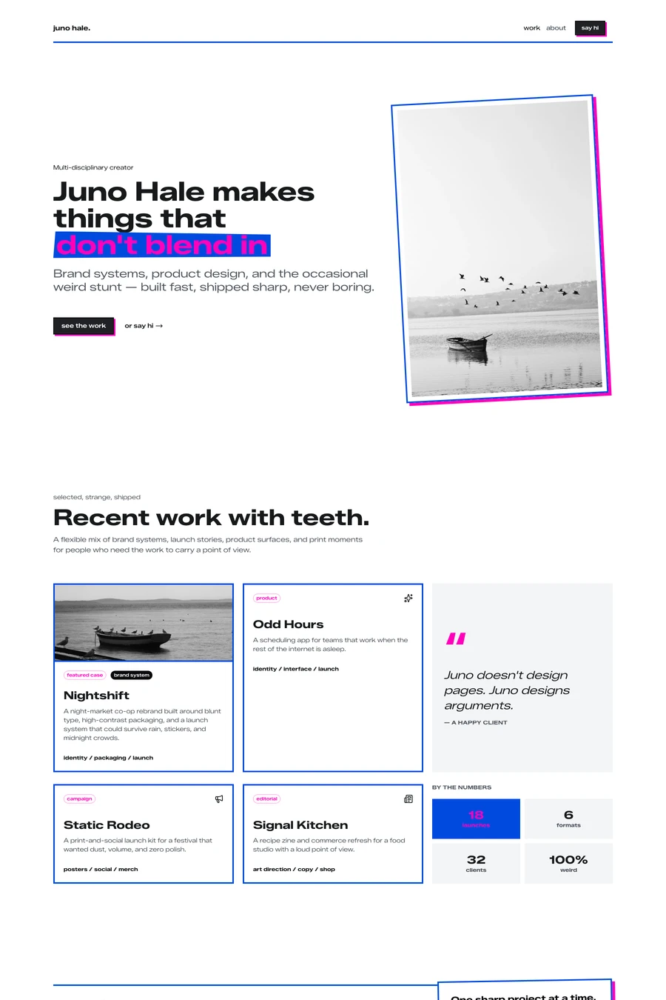](juno/)

A colorful neo-brutalist portfolio template for creative makers who want to present projects, personality, and contact details with confidence.

[Live demo](https://studio.swebsy.com/templates/juno/preview/) · [Edit in Swebsy](https://studio.swebsy.com/create?template=juno&ref=github) · [Details](https://swebsy.com/templates/juno/)

### [Halsey](halsey/)

[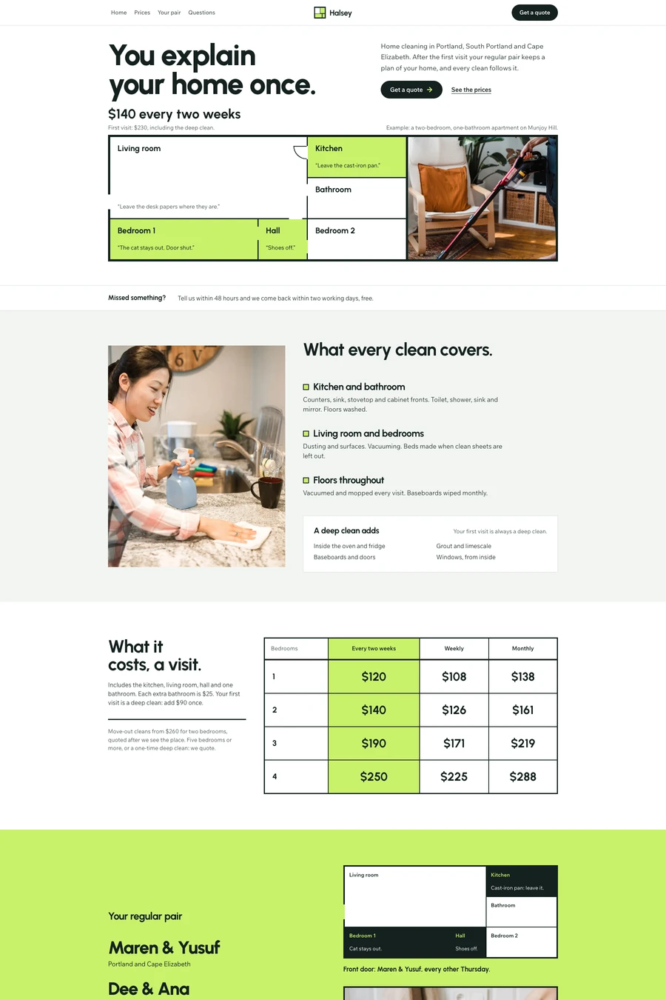](halsey/)

A home-cleaning site built around a floor plan of your home, with room notes, a price table by bedrooms and your regular pair.

[Live demo](https://studio.swebsy.com/templates/halsey/preview/) · [Edit in Swebsy](https://studio.swebsy.com/create?template=halsey&ref=github) · [Details](https://swebsy.com/templates/halsey/)

### [Scope](scope/)

[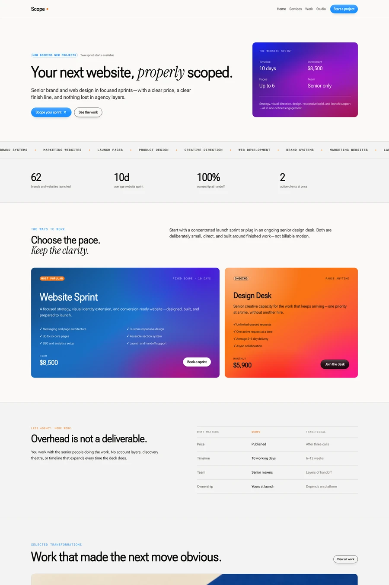](scope/)

A bold editorial studio template for fixed-scope brand and web services, with pricing, work, case study, studio, and inquiry pages.

[Live demo](https://studio.swebsy.com/templates/scope/preview/) · [Edit in Swebsy](https://studio.swebsy.com/create?template=scope&ref=github) · [Details](https://swebsy.com/templates/scope/)

### [Ocho Ventanas](ocho-ventanas/)

[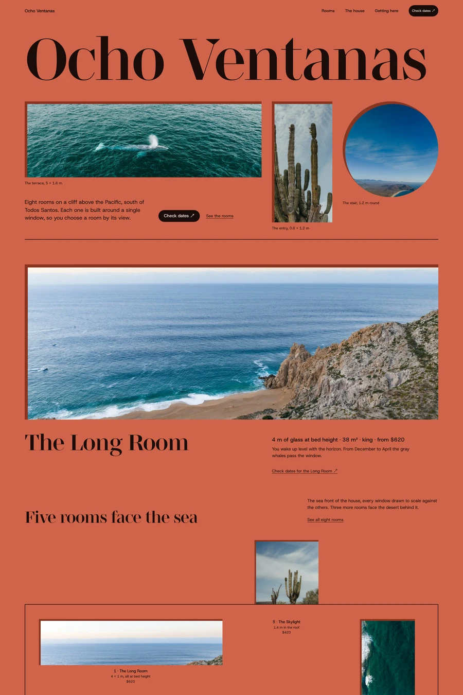](ocho-ventanas/)

A small cliffside guesthouse where every photo is a window cut in a terracotta wall, drawn to true scale, with a building elevation as the room index.

[Live demo](https://studio.swebsy.com/templates/ocho-ventanas/preview/) · [Edit in Swebsy](https://studio.swebsy.com/create?template=ocho-ventanas&ref=github) · [Details](https://swebsy.com/templates/ocho-ventanas/)

### [Hollis](hollis/)

[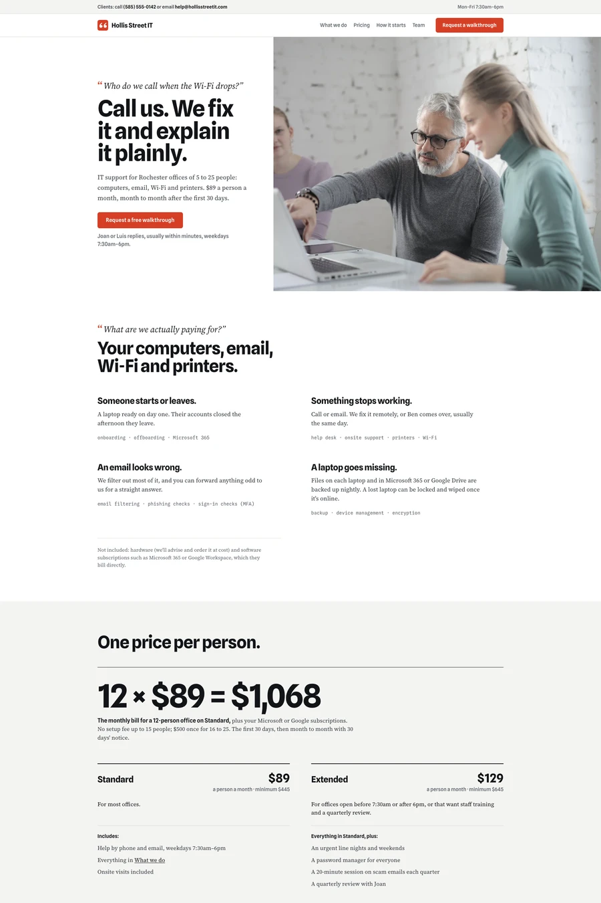](hollis/)

An IT firm's site drawn around the client's own office plan: pins show what's covered, lit desks make the price, a route walks the first visit.

[Live demo](https://studio.swebsy.com/templates/hollis/preview/) · [Edit in Swebsy](https://studio.swebsy.com/create?template=hollis&ref=github) · [Details](https://swebsy.com/templates/hollis/)

### [Forge](forge/)

[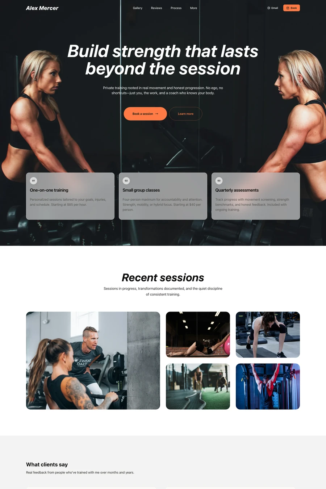](forge/)

A bold training website for coaches who build sustainable strength through real movement, honest progress, and focused one-to-one support.

[Live demo](https://studio.swebsy.com/templates/forge/preview/) · [Edit in Swebsy](https://studio.swebsy.com/create?template=forge&ref=github) · [Details](https://swebsy.com/templates/forge/)

### [Ottoline](ottoline/)

[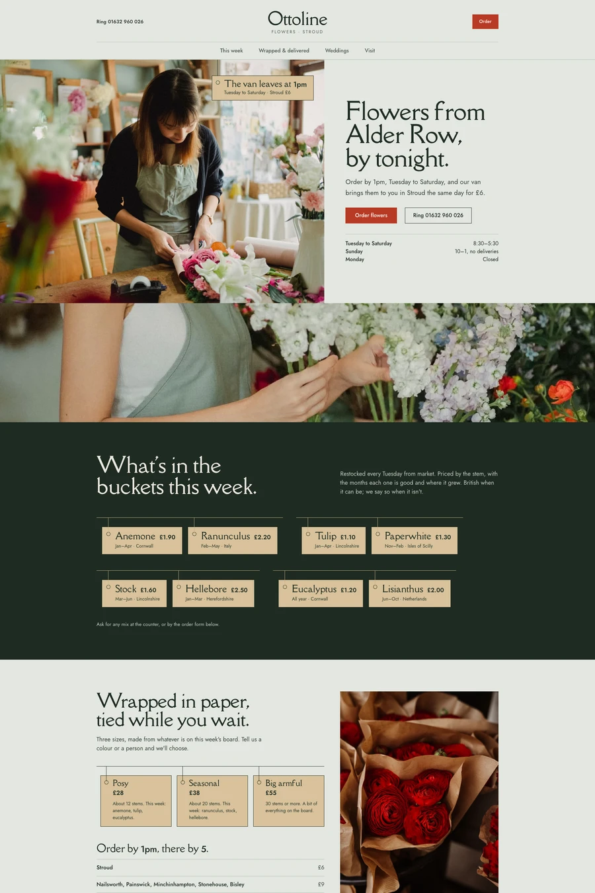](ottoline/)

A neighbourhood florist where every stem hangs on a kraft tag with its price, its months and where it grew, plus same-day delivery, weddings by month and an order form.

[Live demo](https://studio.swebsy.com/templates/ottoline/preview/) · [Edit in Swebsy](https://studio.swebsy.com/create?template=ottoline&ref=github) · [Details](https://swebsy.com/templates/ottoline/)

### [Teague](teague/)

[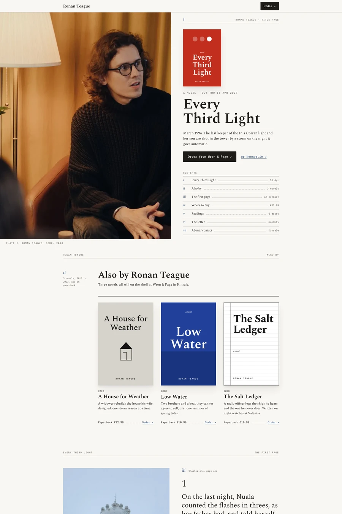](teague/)

A novelist's site read as the book, outside in: a title spread with a portrait plate and contents list, numbered front-matter pages, and a red back cover.

[Live demo](https://studio.swebsy.com/templates/teague/preview/) · [Edit in Swebsy](https://studio.swebsy.com/create?template=teague&ref=github) · [Details](https://swebsy.com/templates/teague/)

### [Poplink](poplink/)

[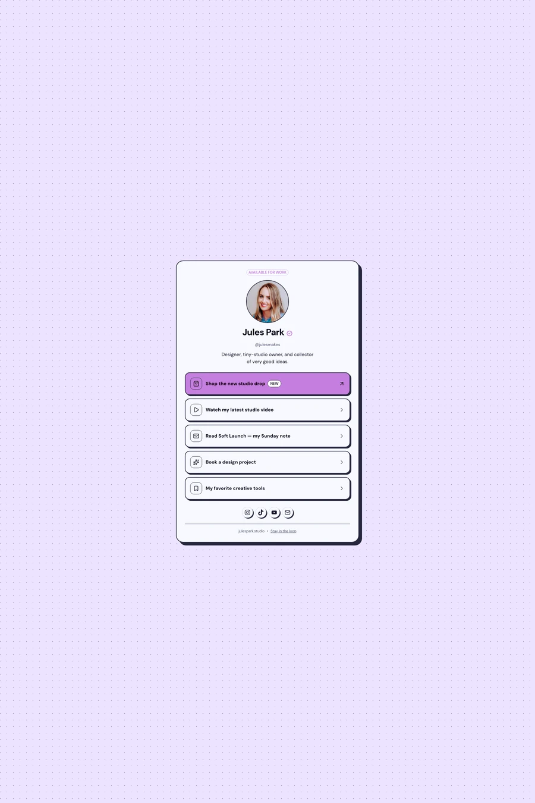](poplink/)

A bright, playful link-in-bio template that helps creators collect social profiles, featured content, and essential links on one memorable page.

[Live demo](https://studio.swebsy.com/templates/poplink/preview/) · [Edit in Swebsy](https://studio.swebsy.com/create?template=poplink&ref=github) · [Details](https://swebsy.com/templates/poplink/)

### [Margin](margin/)

[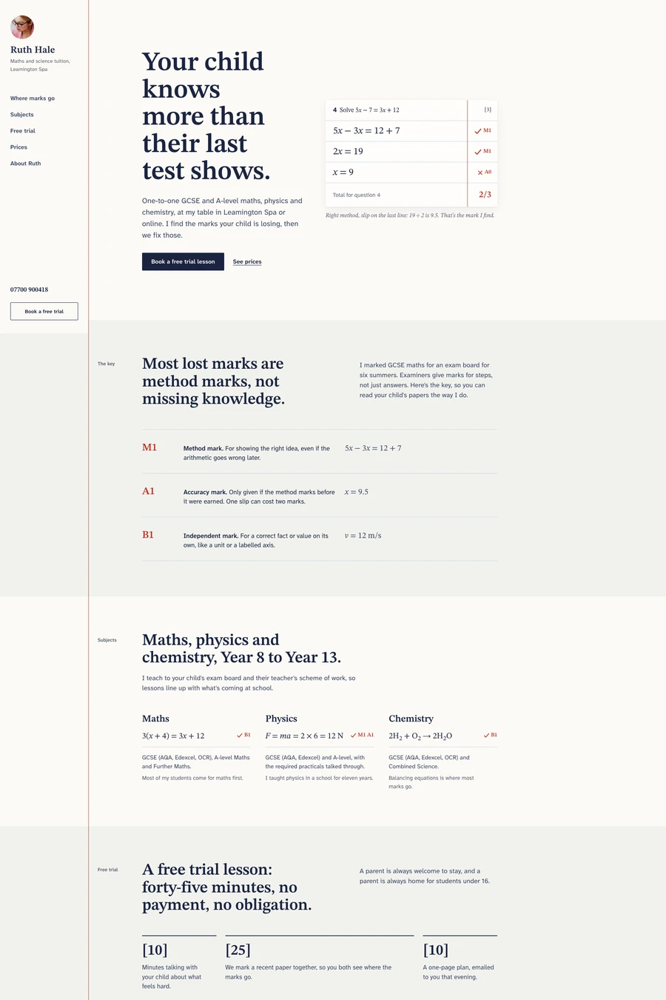](margin/)

An independent tutor's site set like a marked exam paper: a margin rail, a worked answer marked M1 A0, the mark key, subjects, a free trial, results, fees and a booking form.

[Live demo](https://studio.swebsy.com/templates/margin/preview/) · [Edit in Swebsy](https://studio.swebsy.com/create?template=margin&ref=github) · [Details](https://swebsy.com/templates/margin/)

### [Varnish](varnish/)

[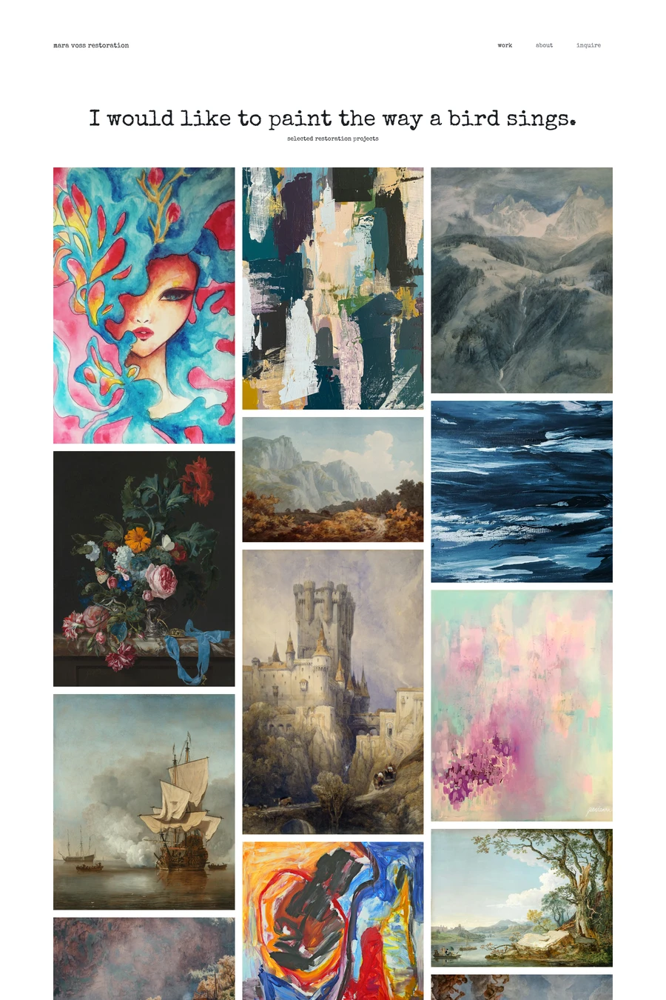](varnish/)

A refined multi-page portfolio template for artists and creative studios to frame signature work, studio context, and thoughtful inquiries.

[Live demo](https://studio.swebsy.com/templates/varnish/preview/) · [Edit in Swebsy](https://studio.swebsy.com/create?template=varnish&ref=github) · [Details](https://swebsy.com/templates/varnish/)

### [Gather](gather/)

[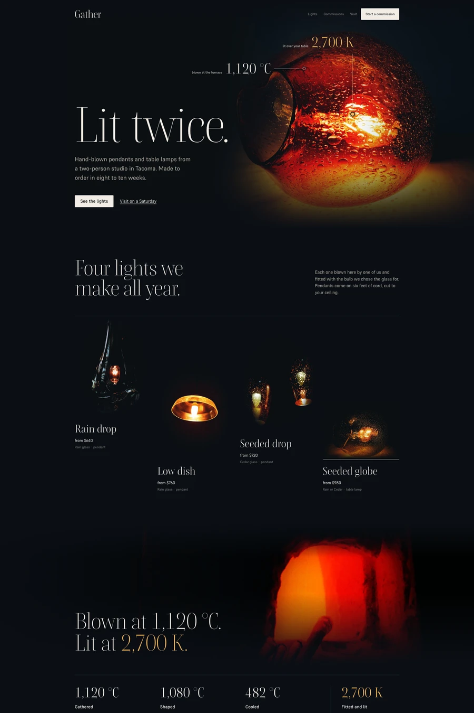](gather/)

A glass studio that hand-blows lighting, dark by default: a lamp that fades up from dark, a wall of lights that switch on as you scroll, and a commission form.

[Live demo](https://studio.swebsy.com/templates/gather/preview/) · [Edit in Swebsy](https://studio.swebsy.com/create?template=gather&ref=github) · [Details](https://swebsy.com/templates/gather/)

### [Ashby](ashby/)

[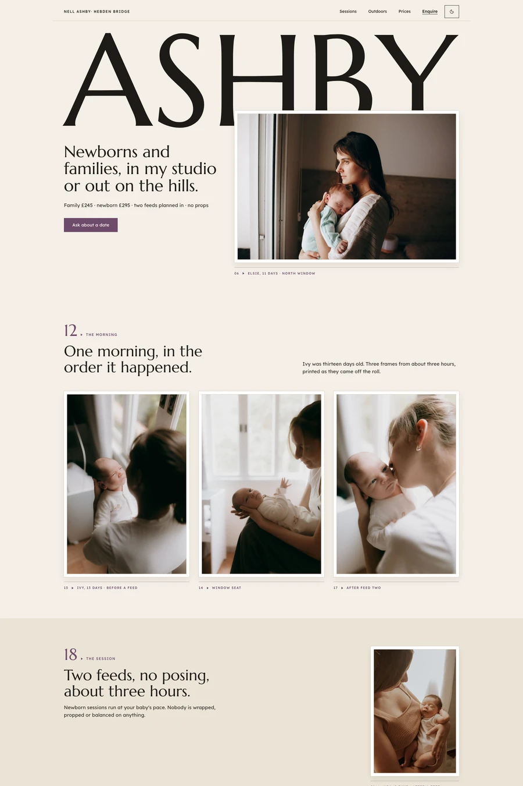](ashby/)

A newborn and family photographer's dark site: uncropped prints on a darkroom bench, each with a film-edge caption, laid out as one 36-frame roll.

[Live demo](https://studio.swebsy.com/templates/ashby/preview/) · [Edit in Swebsy](https://studio.swebsy.com/create?template=ashby&ref=github) · [Details](https://swebsy.com/templates/ashby/)

### [Clearcoat](clearcoat/)

[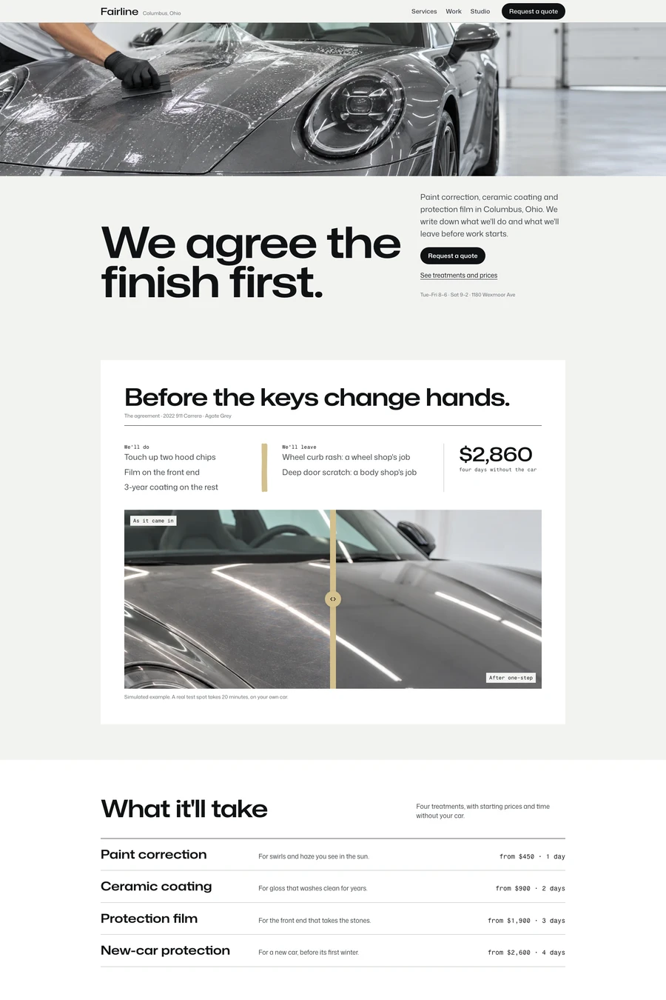](clearcoat/)

A paint-care and detailing studio: a before/after slider, treatments with honest limits and prices, and job notes on what was agreed.

[Live demo](https://studio.swebsy.com/templates/clearcoat/preview/) · [Edit in Swebsy](https://studio.swebsy.com/create?template=clearcoat&ref=github) · [Details](https://swebsy.com/templates/clearcoat/)

### [Morrow](morrow/)

[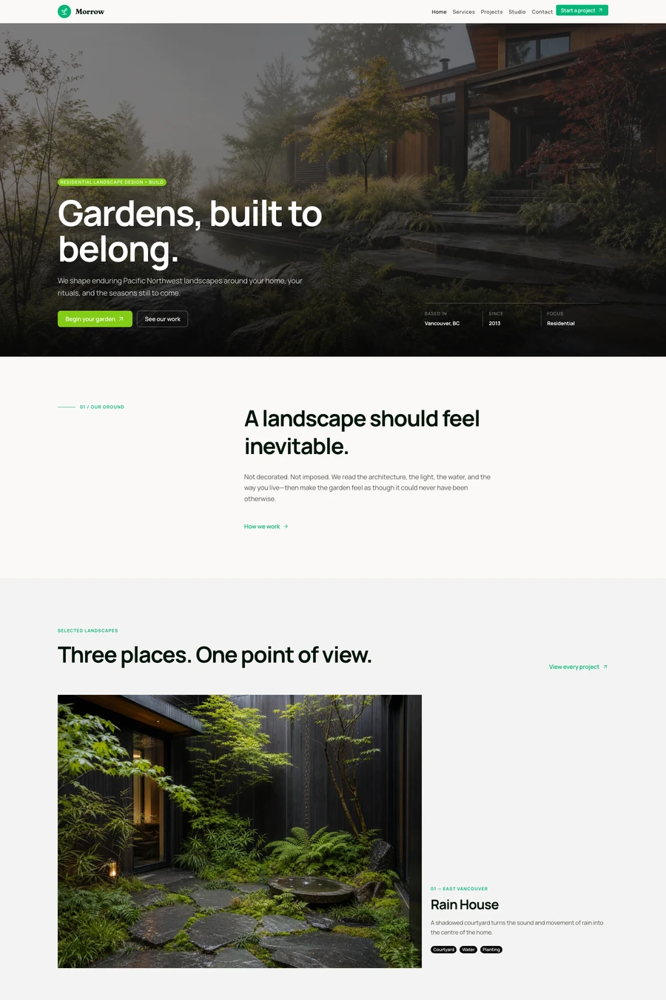](morrow/)

A premium editorial website for residential landscape design-build studios, with immersive project storytelling, services, studio profile, and direct-contact conversion.

[Live demo](https://studio.swebsy.com/templates/morrow/preview/) · [Edit in Swebsy](https://studio.swebsy.com/create?template=morrow&ref=github) · [Details](https://swebsy.com/templates/morrow/)

### [Khevi](khevi/)

[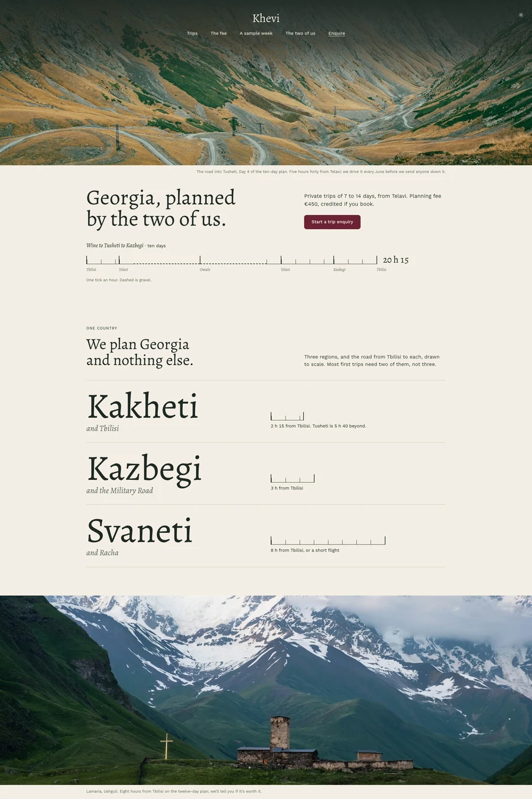](khevi/)

A two-person trip planner's site where every road is drawn to scale, one tick an hour: the route, regions, three trips and a sample week.

[Live demo](https://studio.swebsy.com/templates/khevi/preview/) · [Edit in Swebsy](https://studio.swebsy.com/create?template=khevi&ref=github) · [Details](https://swebsy.com/templates/khevi/)

### [Backrow](backrow/)

A yoga and Pilates studio site for nervous beginners: regulars by where they put their mat, the week, three ways to start and prices.

[Live demo](https://studio.swebsy.com/templates/backrow/preview/) · [Edit in Swebsy](https://studio.swebsy.com/create?template=backrow&ref=github) · [Details](https://swebsy.com/templates/backrow/)

### [Imprint](imprint/)

A refined multi-page designer portfolio for presenting identity work, creative services, client proof, and a focused inquiry path.

[Live demo](https://studio.swebsy.com/templates/imprint/preview/) · [Edit in Swebsy](https://studio.swebsy.com/create?template=imprint&ref=github) · [Details](https://swebsy.com/templates/imprint/)

### [Canal Street](canal-street/)

A volunteer pickup basketball club drawn on its own court lines: a centre-circle hero, the week as a lane, levels on the three-point arc.

[Live demo](https://studio.swebsy.com/templates/canal-street/preview/) · [Edit in Swebsy](https://studio.swebsy.com/create?template=canal-street&ref=github) · [Details](https://swebsy.com/templates/canal-street/)

### [Aurora Glass](aurora-glass-link-in-bio/)

A luminous glass link-in-bio template with social links, featured media, product cards, and an animated aurora background in light and dark modes.

[Live demo](https://studio.swebsy.com/templates/aurora-glass-link-in-bio/preview/) · [Edit in Swebsy](https://studio.swebsy.com/create?template=aurora-glass-link-in-bio&ref=github) · [Details](https://swebsy.com/templates/aurora-glass-link-in-bio/)

### [Kindred](kindred/)

A warm, paper-textured template for a small immigration law practice, with flat fees, partner stories, client outcomes and a consultation form.

[Live demo](https://studio.swebsy.com/templates/kindred/preview/) · [Edit in Swebsy](https://studio.swebsy.com/create?template=kindred&ref=github) · [Details](https://swebsy.com/templates/kindred/)

### [Calder](calder/)

A neighbourhood church site set as the duplicated order of service: every step of Sunday, timed, with a blue rubric telling newcomers what to do.

[Live demo](https://studio.swebsy.com/templates/calder/preview/) · [Edit in Swebsy](https://studio.swebsy.com/create?template=calder&ref=github) · [Details](https://swebsy.com/templates/calder/)

### [Vantage](vantage/)

A bold portfolio template for product designers, creative leads, and independent consultants who want to show work and strategic range.

[Live demo](https://studio.swebsy.com/templates/vantage/preview/) · [Edit in Swebsy](https://studio.swebsy.com/create?template=vantage&ref=github) · [Details](https://swebsy.com/templates/vantage/)

### [Undercoat](undercoat/)

A dog groomer's site built around each coat's routine: how often it comes back, the finish, prices by coat and a short new-dog enquiry.

[Live demo](https://studio.swebsy.com/templates/undercoat/preview/) · [Edit in Swebsy](https://studio.swebsy.com/create?template=undercoat&ref=github) · [Details](https://swebsy.com/templates/undercoat/)

### [Tenpenny](tenpenny/)

A tattoo studio page told as a stencil coming into register: off in the hero, nearer each section, and in place at the enquiry form.

[Live demo](https://studio.swebsy.com/templates/tenpenny/preview/) · [Edit in Swebsy](https://studio.swebsy.com/create?template=tenpenny&ref=github) · [Details](https://swebsy.com/templates/tenpenny/)

### [Marigold](marigold/)

A crisp, high-contrast SaaS site for scheduling and practice-management products, pairing deep navy with electric blue across a product tour, pricing tiers and customer stories.

[Live demo](https://studio.swebsy.com/templates/marigold/preview/) · [Edit in Swebsy](https://studio.swebsy.com/create?template=marigold&ref=github) · [Details](https://swebsy.com/templates/marigold/)

### [Hob](hob/)

A small app's waitlist page set as one week in a shared flat: a rota strip runs through a colour band per day, then proof and an empty Monday.

[Live demo](https://studio.swebsy.com/templates/hob/preview/) · [Edit in Swebsy](https://studio.swebsy.com/create?template=hob&ref=github) · [Details](https://swebsy.com/templates/hob/)

### [Wren & Wildflower](wren-wildflower/)

A warm editorial link-in-bio template for small shops and makers, with tactile link buttons, featured products, and a soft clay and sage palette.

[Live demo](https://studio.swebsy.com/templates/wren-wildflower/preview/) · [Edit in Swebsy](https://studio.swebsy.com/create?template=wren-wildflower&ref=github) · [Details](https://swebsy.com/templates/wren-wildflower/)

### [Halflight](halflight/)

A walk-in aperitivo and cocktail bar: a sunlit room, menus by the clock, and copyable texts that help visitors invite friends.

[Live demo](https://studio.swebsy.com/templates/halflight/preview/) · [Edit in Swebsy](https://studio.swebsy.com/create?template=halflight&ref=github) · [Details](https://swebsy.com/templates/halflight/)

### [Porchlight](porchlight/)

A real estate website for a small agent team: big house numbers, every sale on the record, neighborhood guides and a price-opinion form.

[Live demo](https://studio.swebsy.com/templates/porchlight/preview/) · [Edit in Swebsy](https://studio.swebsy.com/create?template=porchlight&ref=github) · [Details](https://swebsy.com/templates/porchlight/)

### [Long Table](long-table/)

A couple's wedding site laid like one long dinner table: the table from above with every place, the day as place settings, questions on place cards.

[Live demo](https://studio.swebsy.com/templates/long-table/preview/) · [Edit in Swebsy](https://studio.swebsy.com/create?template=long-table&ref=github) · [Details](https://swebsy.com/templates/long-table/)

### [Recess](recess/)

A teaching portfolio for a new science teacher: a slab-type name, photos printed as blue and pink duotones, classroom units, a mentor quote and a résumé PDF.

[Live demo](https://studio.swebsy.com/templates/recess/preview/) · [Edit in Swebsy](https://studio.swebsy.com/create?template=recess&ref=github) · [Details](https://swebsy.com/templates/recess/)

### [Roomful](roomful/)

A band website in two grounds: the band and records on white, the shows in a dark full room. Tour dates by leg, tracklists and a real press kit.

[Live demo](https://studio.swebsy.com/templates/roomful/preview/) · [Edit in Swebsy](https://studio.swebsy.com/create?template=roomful&ref=github) · [Details](https://swebsy.com/templates/roomful/)

### [Linker](linker/)

A sleek link-in-bio template for collecting important links, featured highlights, social profiles, and personal brand essentials in one place.

[Live demo](https://studio.swebsy.com/templates/linker/preview/) · [Edit in Swebsy](https://studio.swebsy.com/create?template=linker&ref=github) · [Details](https://swebsy.com/templates/linker/)

### [Lume](lume/)

A bright portfolio template for freelance UX and product designers to introduce their practice, selected work, services, and contact path.

[Live demo](https://studio.swebsy.com/templates/lume/preview/) · [Edit in Swebsy](https://studio.swebsy.com/create?template=lume&ref=github) · [Details](https://swebsy.com/templates/lume/)

### [Compass](compass/)

A calm services template for executive, leadership, and career coaches to explain outcomes, compare pathways, and invite discovery calls.

[Live demo](https://studio.swebsy.com/templates/compass/preview/) · [Edit in Swebsy](https://studio.swebsy.com/create?template=compass&ref=github) · [Details](https://swebsy.com/templates/compass/)

### [Byline](byline/)

A clips site for a reporter: the beat as one serif sentence, captioned photos, selected stories with what each one changed, an editor's quote and a résumé PDF.

[Live demo](https://studio.swebsy.com/templates/byline/preview/) · [Edit in Swebsy](https://studio.swebsy.com/create?template=byline&ref=github) · [Details](https://swebsy.com/templates/byline/)

### [Craft](craft/)

A focused, minimal portfolio template for makers and creators who want their strongest projects and capabilities to take center stage.

[Live demo](https://studio.swebsy.com/templates/craft/preview/) · [Edit in Swebsy](https://studio.swebsy.com/create?template=craft&ref=github) · [Details](https://swebsy.com/templates/craft/)

### [Artup](artup/)

A polished personal portfolio template for designers and creators to showcase their work, story, process, and distinctive style.

[Live demo](https://studio.swebsy.com/templates/artup/preview/) · [Edit in Swebsy](https://studio.swebsy.com/create?template=artup&ref=github) · [Details](https://swebsy.com/templates/artup/)

### [Daybreak](daybreak/)

An editorial, multi-page template for specialty coffee roasters, with dedicated spaces for the menu, coffee, story, and visit information.

[Live demo](https://studio.swebsy.com/templates/daybreak/preview/) · [Edit in Swebsy](https://studio.swebsy.com/create?template=daybreak&ref=github) · [Details](https://swebsy.com/templates/daybreak/)

## License

Free for any number of personal and commercial sites, changed however you like,
under the [Swebsy Free Template License](LICENSE). Two conditions:

- Keep the **"Made with Swebsy" badge** on the site as shipped. On a paid
  [Swebsy](https://swebsy.com/pricing) plan you may remove it.
- Don't redistribute or sell the templates as templates without permission.
  Linking here is always fine.

Photos keep their own licenses (mostly Unsplash and Pexels); fonts keep their
open font licenses (mostly SIL OFL).
