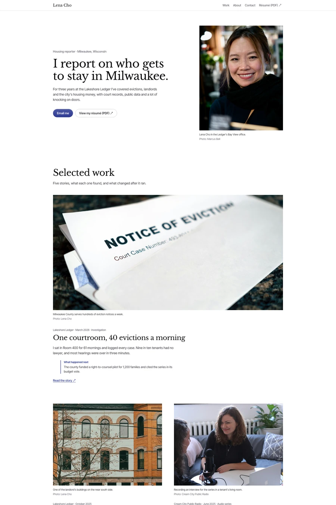

# Byline — free resume website template

A clips site for a reporter: the beat as one serif sentence, captioned photos, selected stories with what each one changed, an editor's quote and a résumé PDF.

Good for: Journalists, Reporters, Writers, Clips portfolios.

- [Live demo](https://studio.swebsy.com/templates/byline/preview/)
- [Edit in Swebsy](https://studio.swebsy.com/create?template=byline&ref=github), the free visual editor, no account needed
- [Template details](https://swebsy.com/templates/byline/)

## Use it

`site/` is the whole website. Open `site/index.html` locally, or upload the
folder to any static host. Replace `site/robots.txt` rules as needed and add a
sitemap once you know your domain (Swebsy writes one when you set a Site URL).

## License

Free for any number of personal and commercial sites, changed however you like,
under the [Swebsy Free Template License](../LICENSE). Two conditions:

- Keep the **"Made with Swebsy" badge** on the site as shipped. On a paid
  [Swebsy](https://swebsy.com/pricing) plan you may remove it.
- Don't redistribute or sell the templates as templates without permission.
  Linking here is always fine.

Photos keep their own licenses (mostly Unsplash and Pexels); fonts keep their
open font licenses (mostly SIL OFL).
