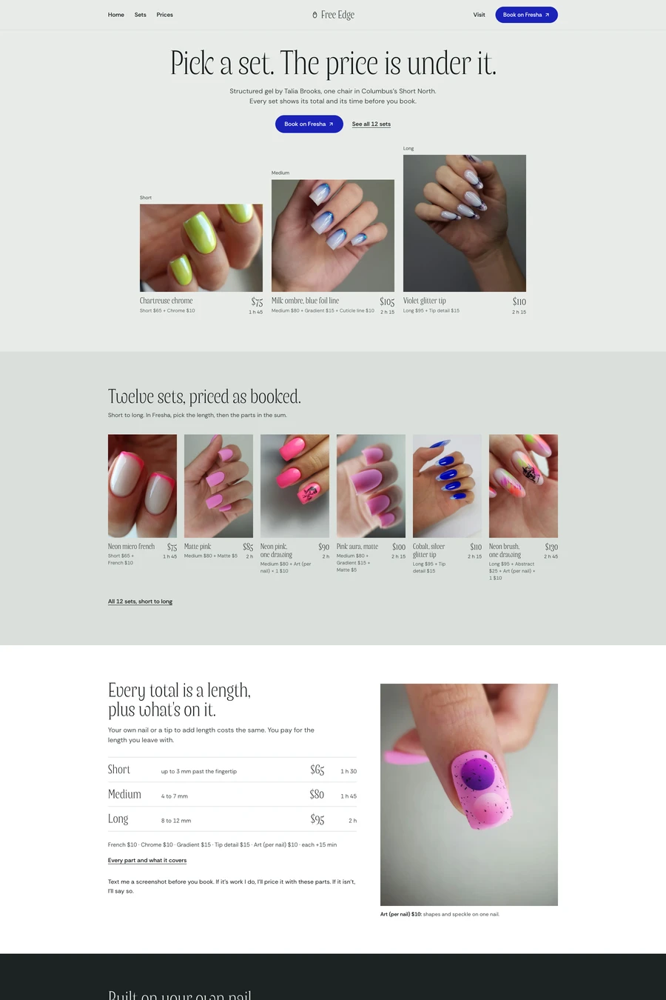

# Free Edge — free local business website template

A one-chair nail studio site where every set shows its total and its time: a staircase of hands stepping with length, sets priced as booked, and a price page with no "from".

Good for: Nail studios, Solo nail techs in a salon suite, Lash and brow studios, Appointment-only beauty services.

- [Live demo](https://studio.swebsy.com/templates/free-edge/preview/)
- [Edit in Swebsy](https://studio.swebsy.com/create?template=free-edge&ref=github), the free visual editor, no account needed
- [Template details](https://swebsy.com/templates/free-edge/)

## Use it

`site/` is the whole website. Open `site/index.html` locally, or upload the
folder to any static host. Replace `site/robots.txt` rules as needed and add a
sitemap once you know your domain (Swebsy writes one when you set a Site URL).

## License

Free for any number of personal and commercial sites, changed however you like,
under the [Swebsy Free Template License](../LICENSE). Two conditions:

- Keep the **"Made with Swebsy" badge** on the site as shipped. On a paid
  [Swebsy](https://swebsy.com/pricing) plan you may remove it.
- Don't redistribute or sell the templates as templates without permission.
  Linking here is always fine.

Photos keep their own licenses (mostly Unsplash and Pexels); fonts keep their
open font licenses (mostly SIL OFL).
